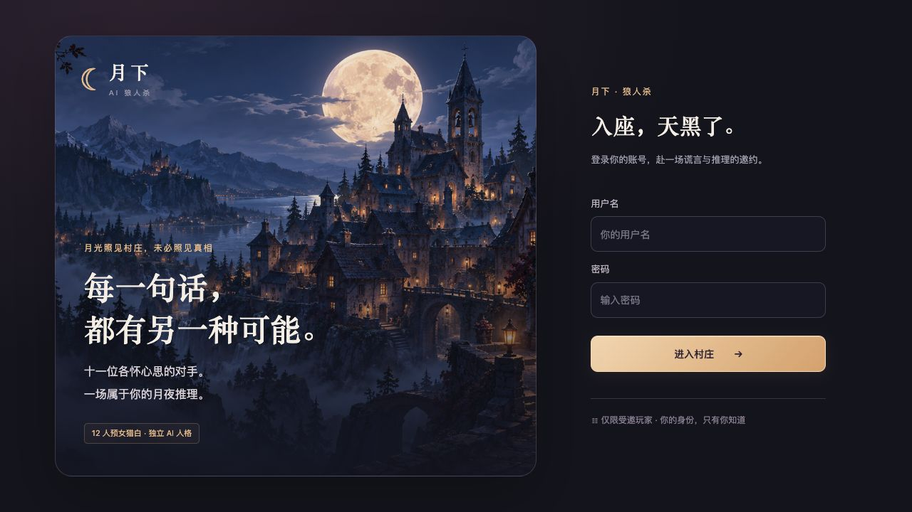
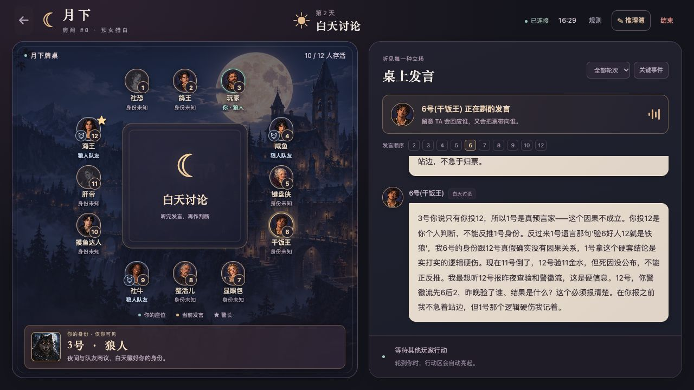
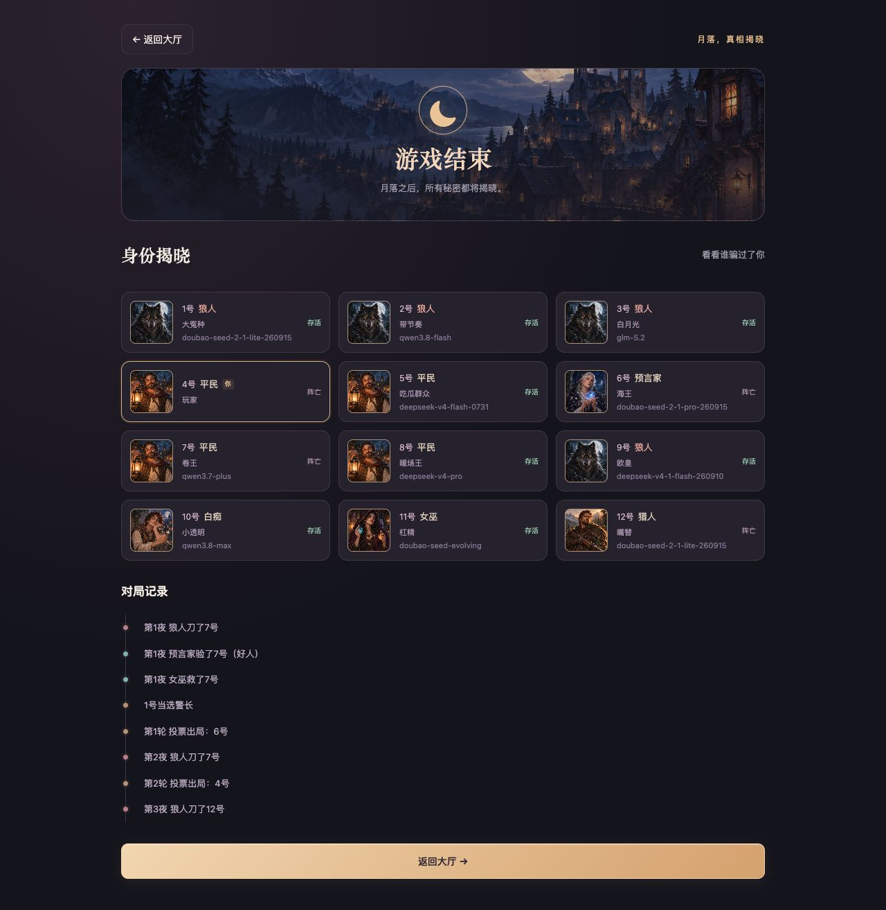

# 月下 · AI 狼人杀

一个人也能开局的 12 人文字狼人杀：**1 位真人，与 11 位 AI 同桌推理。**

每位 AI 有自己的身份、性格和个人视角记忆，会发言、投票、争夺警徽，也会判断错误。你可以把不同平台的模型放进同一个模型池，让它们在一局游戏中扮演不同玩家。



## 可以玩什么

- **完整的预女猎白对局**：夜间技能、警长竞选、白天发言、投票放逐、遗言和结算。
- **独立的 AI 视角**：按身份筛选信息，狼人共享队内讨论，预言家和女巫保留自己的技能结果。
- **页面管理模型**：支持百炼、火山方舟和 OpenAI 兼容服务，同一平台和 Base URL 可配置多个模型。
- **灵活的开局模型池**：平台与模型数量不设上限，至少一个可用模型即可开局，每局为 11 个 AI 座位随机分配模型。
- **适配电脑和手机**：圆桌座位、当前发言、投票票型、狼人队友标记，以及保存在本机浏览器的推理笔记。
- **对局记录与复盘**：查看历史对局、结算身份、关键事件和按玩家／模型统计的胜率。

当前版本适合本地体验和开发。公网部署前仍需完善账号、会话和日志安全，具体限制见下文。

## 游戏画面

白天讨论：圆桌展示座位、存活状态和狼人队友，右侧查看各位玩家的发言。



对局结束后，可以查看所有玩家的身份、使用的模型，以及夜间行动和放逐等关键事件。



游戏内画面取自已有真实对局记录，个人昵称已匿名化。

## 快速开始

### 1. 安装依赖

准备 Python 和 pip；当前本地验证使用 **Python 3.11**。下载源码后，在包含 `main.py` 和 `requirements.txt` 的项目根目录执行：

```bash
python3 -m venv .venv
source .venv/bin/activate
python -m pip install -r requirements.txt
```

Windows PowerShell 可使用：

```powershell
py -3.11 -m venv .venv
.\.venv\Scripts\Activate.ps1
python -m pip install -r requirements.txt
```

前端是原生 HTML/CSS/JavaScript，无需安装前端依赖或执行构建。

### 2. 启动服务

```bash
python -m uvicorn main:app --host 127.0.0.1 --port 8000
```

打开 [http://127.0.0.1:8000](http://127.0.0.1:8000)。首次启动会创建 `data/werewolf.db`、初始化表结构和账号。

**全新数据库的初始账号默认是 `admin` / `admin`。** 可以在项目根目录的 `.env` 里用 `WW_ADMIN_USERNAME` 和 `WW_ADMIN_PASSWORD` 改掉；不写或留空仍使用这个默认值。这两项只在第一次创建用户时生效。已有数据库保留原账号和密码。旧库第一次补管理员身份时，只把用户名与 `WW_ADMIN_USERNAME` 相同的真人标为管理员，不会因为有人叫 admin 就授予权限。不要用默认口令把服务开放到公网。

### 3. 配置模型并开局

1. 管理员登录后，在大厅打开「模型配置」。
2. 添加平台，填写模型名和 API Key；兼容模式还需填写 Base URL。
3. 选择一个模型，点击「测试连通」检查接口是否可调用。
4. 勾选将平台模型加入对局池，点击「保存配置」。
5. 返回大厅，点击开始对局。

**无需创建 `.env` 或修改代码来配置模型。** 没有可用模型时，开始按钮置灰并提示去配置；普通玩家需要联系管理员。管理员也可在大厅创建其他真人账号，玩家共用该服务的模型池。

真实对局和连通测试会使用你配置的模型服务，调用费用以供应商的账户规则为准。

## 模型配置

| 模式 | 必填内容 | 接口地址 |
| --- | --- | --- |
| 百炼 | 模型名、API Key | `https://dashscope.aliyuncs.com/compatible-mode/v1` |
| 火山方舟 | 模型名、API Key | `https://ark.cn-beijing.volces.com/api/v3` |
| OpenAI 兼容 | 模型名、Base URL、API Key | 自定义 Chat Completions API 根地址，例如 `https://api.openai.com/v1` |

### 一个配置，多个模型

模型名可以自定义填写，每行一个。同一平台配置中的模型共用 Base URL 和 API Key，例如：

```text
my-chat-model
my-small-model
my-custom-model
```

以上名称仅用于说明填写格式，请使用你的服务实际提供的模型名或模型接入点 ID。兼容模式填写 API 根地址，不要附加 `/chat/completions`。

模型分配规则：

- 超过 11 个可用模型：随机抽取 11 个模型配置。
- 1–11 个可用模型：先抽取可用配置，不足的座位随机重复分配。
- 没有可用模型：真实模式不能开局。

这里的“可用”指平台已启用、已填写密钥，且模型未被标记为不支持关闭思考。保存配置不会自动验证所有模型的连通性，建议先测试。不同平台配置中的同名模型会按各自的地址和密钥调用；战绩保存本局实际使用的模型名。

### 思考模式

**Thinking 固定关闭，没有开启选项。** 仅支持思考模式、无法关闭的已识别模型会显示不可用，不参与开局。

兼容服务对关闭思考的参数格式可能不同，可以在高级设置中选择自动适配、`enable_thinking`、`thinking.type`、`reasoning_effort`，或非思考模型的「无需参数」。这些选项只选择关闭思考的请求格式。模型还需要能按提示返回有效 JSON，是否支持以实际服务能力和连通测试结果为准。

### 测试与密钥保存

「测试连通」使用当前表单内容调用选中的一个模型，最长等待 20 秒，显示结果和耗时；**测试不会保存表单，也不会测试整个平台的所有模型。**

完整 API Key 保存于服务端数据库，页面只显示首尾脱敏摘要。编辑时留空保留已保存的密钥，填写新 Key 则替换；更换平台或 Base URL 后需要重新填写。密钥不会写入浏览器存储，但数据库中的密钥目前没有加密，需要保护数据库和备份。

保存后配置立即生效。未结束的对局正在使用的配置可以停用或更新密钥；删除平台、移除被使用的模型或更换地址，需要等待相关对局结束。

## 游戏规则

| 项目 | 本项目规则 |
| --- | --- |
| 阵容 | 4 狼人、4 平民、预言家、女巫、猎人、白痴各 1 |
| 胜负 | 屠边：狼人全部死亡则好人获胜；神职或平民全部死亡则狼人获胜 |
| 首日流程 | 第一夜行动 → 竞选警长 → 公布死亡 → 遗言与技能 → 发言 → 放逐 |
| 警长 | 日投计 1.5 票，选择发言方向并最后发言；死亡可移交或撕毁警徽 |
| 平票 | 平票玩家 PK，符合投票条件的台下玩家复投；再次平票则无人出局或无警长 |
| 女巫 | 解药、毒药各一次，每晚最多一药，首夜可自救；解药用完不再获知刀口 |
| 猎人 | 被毒不能开枪，其他适用的死亡可开枪，支持连锁结算 |
| 白痴 | 首次被放逐时翻牌免死，永久失去投票权，仍可发言 |
| 遗言 | 首夜死亡和白天放逐有遗言；后续夜死、自爆、被枪带走无遗言 |

夜间死亡只公布座位，不公开死因。狼人可以自刀、连续刀同一目标，在发言或竞选演说时可以自爆；警上自爆会吞掉警徽。投票允许弃票，不能投自己。

## 不配置模型也能预览

只想检查界面和操作流程，可以启动模拟服务：

```bash
python -m uvicorn scripts.ui_preview:app --host 127.0.0.1 --port 8787
```

打开 [http://127.0.0.1:8787](http://127.0.0.1:8787)，用与正式服务相同的初始账号登录。未配置时是 `admin` / `admin`。页面会显示「模拟 AI」标记，无需模型配置，也不会调用真实模型或执行连通测试。

预览默认使用系统临时目录中的 `ww-ui-preview.db`。如果环境中已经设置 `WW_DB_URL`，预览会使用该地址；请指定独立数据库，避免与真实对局混用。模拟发言只用于流程验证，不代表真实模型的推理表现。

## Docker 本地运行

Dockerfile 当前基于 Python 3.9。在项目根目录执行：

```bash
docker build -f docker/Dockerfile -t yuexia-ai-werewolf .
docker volume create yuexia-ai-werewolf-data
docker run --name yuexia-ai-werewolf \
  --publish 127.0.0.1:8001:8000 \
  --mount type=volume,source=yuexia-ai-werewolf-data,target=/app/data \
  yuexia-ai-werewolf
```

打开 [http://127.0.0.1:8001](http://127.0.0.1:8001)，按上面的步骤配置模型。命名卷用于保留模型配置、账号和对局数据；新镜像不包含本地 `data/`、`.env` 或 Git 历史。

仓库中的 Compose 示例把服务绑定在本机 `127.0.0.1:8001`，`.env` 可选。需要自定义初始管理员时，从 `.env.example` 复制一份。这个示例没有配置数据卷；需要长期保存数据时，请补充 `/app/data` 的挂载。快速本地体验可以使用上面的命令。

## 运行配置与数据

模型的地址、密钥和列表通过页面管理。数据库、请求超时等运行参数可用 `WW_` 环境变量或可选的 `.env` 设置，详见 [config.py](config.py)。例如：

```dotenv
WW_ADMIN_USERNAME=admin
WW_ADMIN_PASSWORD=admin
WW_LLM_TIMEOUT_SECONDS=45
WW_LLM_DECISION_TIMEOUT_SECONDS=120
WW_HUMAN_ACTION_TIMEOUT_SECONDS=2400
```

| 环境变量 | 默认值 | 用途 |
| --- | --- | --- |
| `WW_ADMIN_USERNAME` | `admin` | 全新数据库的管理员用户名；留空也使用默认值 |
| `WW_ADMIN_PASSWORD` | `admin` | 全新数据库的管理员密码；不修改已有账号 |
| `WW_DB_URL` | 项目目录下的 `data/werewolf.db`，使用 SQLite | SQLAlchemy 异步数据库连接 URL |
| `WW_LLM_TEMPERATURE` | `0.75` | 默认采样温度，特定模型会使用兼容值 |
| `WW_LLM_MAX_TOKENS` | `1024` | 默认输出额度，特定模型可能覆盖 |
| `WW_LLM_TIMEOUT_SECONDS` | `45` 秒 | 请求读取超时，流式请求按连续无数据时长计算 |
| `WW_LLM_DECISION_TIMEOUT_SECONDS` | `120` 秒 | 一次决策包含重试的总时间上限 |
| `WW_LLM_AUDIT_PATH` | `data/ai-decisions.jsonl` | 模型诊断日志；设为空可关闭 |
| `WW_CONTEXT_MEMORY_CHARS` | `6500` | 个人记忆的软字符预算 |
| `WW_HUMAN_ACTION_TIMEOUT_SECONDS` | `2400` 秒 | 真人操作等待上限，即 40 分钟 |

SQLite 数据库包含完整平台密钥、用户密码哈希、会话 token 和对局记录。`data/`、环境配置及其备份、常见数据库和日志文件已加入忽略规则；不要将这些数据上传到仓库、Issue 或公开附件。

模型诊断 JSONL 只记录阶段、耗时、失败类别等元数据，达到 2 MiB 后轮转并保留两个备份。部分其他后台异常仍可能输出原始错误，分享终端日志前需要脱敏。

从旧版本升级时，首次创建模型配置表会一次性导入原模型环境配置；后续以页面保存的数据库配置为准。升级前备份数据库，升级后检查模型配置，并清理旧密钥文件。已有同平台、同地址、同密钥的模型会合并为一个平台配置，保留座位绑定的模型 ID。

## AI 如何获得信息

每次决策按该座位的个人视角重新构造上下文：

```text
身份可见事件 + 私密技能结果
  → 公开发言与结果 + 个人判断 + 队内讨论
  → 角色、人格和个人记忆
  → 模型返回 JSON
  → 行动校验 → 必要时重试 → 安全回退
```

公开身份宣称和怀疑不会被当成已证实事实。AI 可能误判、改判或调用失败；一次决策最多尝试两次，失败后投票回退为弃票，必选目标的技能从合法目标中选择。模型连接缓存不保存共享聊天历史。

## 当前限制

- 每局只有一位真人，不支持多真人同桌，也没有语音功能。
- 对局任务和待操作状态保存在单个进程内，使用一个 uvicorn worker；不要通过多 worker 或多个副本运行同一套对局。
- 浏览器重连可以恢复当前状态。后台任务丢失时，仅在完整白天结束、没有待处理技能的恢复点可以继续；不支持任意阶段的服务重启续局。开发时 `--reload` 可能中断对局。
- 接口兼容性和 JSON 输出质量取决于模型服务，配置名称不代表已完成真实模型验证。
- 当前账号和会话实现面向本地体验，尚不适合直接开放到公网。默认管理员口令可以在 `.env` 中更换；仍需处理 AI 账号登录、会话有效期、登录限速，以及 WebSocket URL 中的 token。

## 开发与贡献

后端使用 FastAPI、SQLAlchemy Async 和 SQLite；实时交互使用 WebSocket，模型通过 OpenAI 兼容客户端调用，提示模板使用 Jinja2。前端无需构建工具。

```text
ai/             模型配置、调用适配、个人视角记忆和提示模板
api/            认证、模型配置、对局接口和 WebSocket
engine/         游戏规则、阶段编排、技能与对局恢复
db/             数据库会话、迁移和仓储
models/         持久化模型
schemas/        请求与响应结构
static/         网页、脚本、样式和插画
scripts/        模拟预览与评估工具
tests/          规则、上下文、接口与流程回归测试
docs/           设计说明与评估记录
```

运行测试：

```bash
python -m pytest tests/ -q
```

可选的 JavaScript 语法检查需要 Node.js：

```bash
node --check static/app.js
node --check static/game-availability.js
node --check static/model-settings.js
```

欢迎提交 Issue 或 Pull Request，约定见 [CONTRIBUTING.md](CONTRIBUTING.md)。报告问题时说明运行方式、模型配置模式、出错阶段和复现步骤；删除 API Key、登录 token、个人信息及原始数据库附件。修改规则、上下文或接口行为时，请补充对应回归测试。

更多说明：[游戏审查](docs/gameplay-audit.md) · [视觉设计](docs/art-direction-v2.md)。

## 发布与许可证

本项目采用 [MIT 许可证](LICENSE)，允许使用、修改和分发（包括商业用途），需保留版权声明和许可声明。

公开仓库只包含源码、测试和已匿名化的示例截图。不要提交 `.env`、`data/`、数据库备份、模型密钥或终端日志。报告问题时删除 API Key、登录 token、个人昵称和原始数据库。安全问题的处理方式见 [SECURITY.md](SECURITY.md)。
